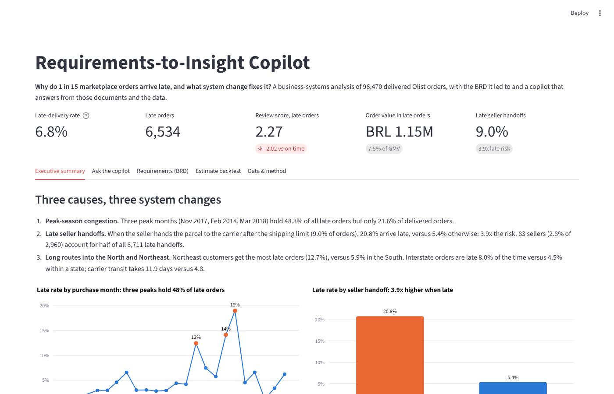
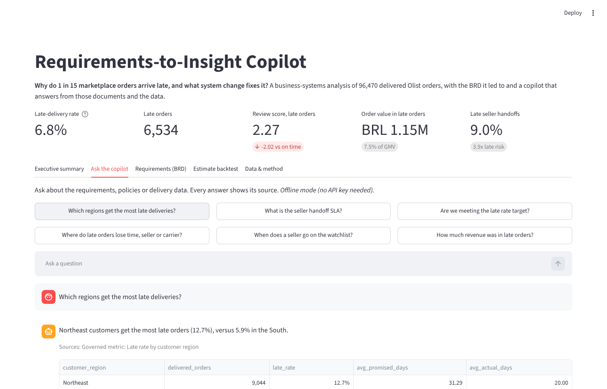
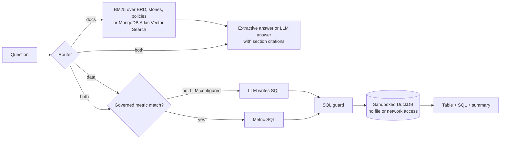

# Requirements-to-Insight Copilot

[](https://github.com/Tanzil-Ali-Rizvi/requirements-insight-copilot/actions/workflows/ci.yml)


[](https://tanzil-requirements-copilot.streamlit.app)

**Why do 1 in 15 marketplace orders arrive late, and what system change fixes it?** A business-systems analysis of 96,470 delivered orders from Olist, a Brazilian e-commerce marketplace, turned into a requirements document and an AI copilot that answers stakeholder questions from those requirements and from the data, always showing its source.

**▶ [Try the live demo](https://tanzil-requirements-copilot.streamlit.app)**: no sign-up or API key needed.



## The answer in 30 seconds

**6.8% of delivered orders (6,534) arrived after the promised date.** Late orders average **2.27 review stars against 4.29**, and 62.4% of them get a 1-2 star review. They carried **BRL 1.15M** of order value (7.5% of GMV).

| Cause | Evidence | System change (BRD) |
| --- | --- | --- |
| Peak-season carrier congestion | Nov 2017, Feb and Mar 2018 hold **48.3% of late orders** but 21.6% of orders; promised dates did not adjust | Route- and load-aware delivery estimate (FR-01) |
| Late seller handoffs | 9.0% of handoffs miss the shipping limit; those orders are late **3.9x as often**; **83 sellers (2.8%) cause half** | Handoff alerts, seller scorecard and watchlist (FR-02) |
| Long routes into the North and Northeast | Northeast late rate **12.7% vs 5.9%** in the South; late orders spend 26.2 days in transit (median) vs 7.0 | Running-late notices (FR-03), peak capacity plan (FR-04) |

Fixing late handoffs alone is linked to up to **1,347 fewer late orders (20.6%)**, an association-based upper bound. A backtest of the new estimate on 52,777 orders from 2018 cut the late rate from **7.73% to 7.06% at the same promise length** (23.6 vs 23.4 days): a real but modest gain, which is why it ships alongside the handoff and notification changes. Full memo: [docs/findings.md](docs/findings.md).

## For analyst reviewers: the business analysis

| Artefact | What it shows |
| --- | --- |
| [Findings memo](docs/findings.md) | Root causes, sizing, backtest, recommendations with owners |
| [Business Requirements Document](docs/BRD.md) | Objectives with baselines and targets, scope, RACI, 5 business, 6 functional and 5 non-functional requirements, risks, traceability matrix |
| [User stories](docs/user_stories.md) | 8 stories with Gherkin acceptance criteria, each traced to a requirement |
| [As-is](docs/process/as_is.md) and [to-be](docs/process/to_be.md) process maps | Swimlane flows with the pain point at each step |
| [Data dictionary](docs/data_dictionary.md) | Star schema: 2 facts, 3 dimensions, every column defined |
| [Policies](docs/policies/) | Seller handling and delivery-promise policies (illustrative, written for this case) |
| [SQL](sql/) | Staging views and star schema; 16 governed metrics in [metrics.py](src/ric/metrics.py) |

## For AI engineering reviewers: the copilot





- **Governed first.** Data questions are matched to 16 metric definitions shared with the dashboard and the memo, so the copilot's numbers always match the report (FR-05). Free-form SQL from an LLM is the fallback, not the default.
- **Two walls around SQL.** A guard allows one read-only `SELECT` with a row cap and blocks file, network and settings functions. The warehouse itself loads tables into memory, then disables external access and locks its configuration, so even SQL that slips past the guard cannot read files. **30/30 red-team queries are blocked** in CI.
- **Runs free, with no API key.** Offline mode uses BM25 retrieval and the metric layer. Set `LLM_BASE_URL` / `LLM_MODEL` for any OpenAI-compatible model (Groq, Gemini, Ollama for fully local use, or my [llm-gateway](https://github.com/Tanzil-Ali-Rizvi/llm-gateway)). Set `MONGODB_URI` to switch document retrieval to Atlas Vector Search.
- **Evaluated honestly.** CI gates on a 48-question set used for tuning, and also reports a 20-question held-out set written after tuning and never tuned on:

| Check | Tuned set | Held-out set | CI gate |
| --- | --- | --- | --- |
| Routing (docs / data / both) | 48/48 (100%) | 19/20 (95%) | 90% |
| Governed metric chosen | 30/30 (100%) | 10/13 (77%) | 90% |
| Document retrieval, top 3 | 20/20 (100%) | 7/8 (88%) | 90% |
| SQL guard, red-team | 30/30 (100%) | n/a | 100% |

The held-out metric score is the known weak spot: keyword matching misses paraphrases such as "How unhappy are customers whose order came late?". LLM mode is the intended fix; the misses are listed in `evals/results.json`.

## Run it

```bash
git clone https://github.com/Tanzil-Ali-Rizvi/requirements-insight-copilot
cd requirements-insight-copilot
pip install -r requirements-dev.txt
streamlit run app/streamlit_app.py      # dashboard + copilot, offline
pytest -q && python evals/run_evals.py  # 73 tests, gated evals
```

The star schema ships as Parquet in `data/warehouse/` (17 MB). To rebuild from the raw CSVs: `make data warehouse analysis backtest`.

## Repository layout

```
docs/         BRD, user stories, process maps, findings memo, policies, data dictionary
sql/          staging views and star schema (DuckDB)
src/ric/      warehouse sandbox, SQL guard, metric layer, retrieval, router, LLM client
app/          Streamlit dashboard and copilot
evals/        tuned set, held-out set, red-team SQL, gated runner
tests/        pytest suite
scripts/      data download, warehouse build, analysis, estimate backtest, Atlas indexing
```

## Data and caveats

Data: [Olist e-commerce public dataset](https://github.com/olist/work-at-olist-data) (MIT licence), orders placed Sep 2016 to Oct 2018. Review text and geolocation are left out of the warehouse. A late order is one delivered after the promised date; order-level seller and region come from the first item (1.3% of orders have more than one seller). All effects are associations from observational data; the BRD requires A/B tests before rollout. The two policy documents are illustrative and written for this case study.

## Author

**Tanzil Ali Rizvi** · Data & Business Analyst · AI Engineer · [LinkedIn](https://www.linkedin.com/in/tanzil-ali-rizvi-7baa691a5/) · [GitHub](https://github.com/Tanzil-Ali-Rizvi)
