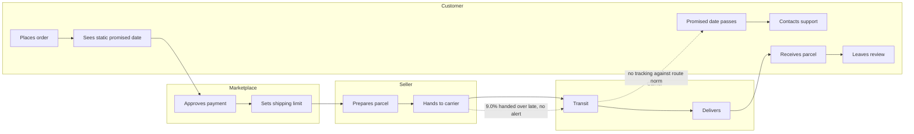

# As-is process: order to delivery

The promise is fixed at checkout, nobody watches the seller deadline or carrier transit, and the customer finds out about a delay only after the promised date has passed.

**Pain points (from [findings.md](../findings.md))**

| Step | Pain point | Evidence |
| --- | --- | --- |
| Static promised date | Ignores route and carrier load | 48.3% of late orders fall in 3 peak months |
| Hand to carrier | No reminder or monitoring | 9.0% of handoffs late; 3.9x late risk |
| Transit | No check against the route's normal time | Late orders: 26.2 days median transit vs 7.0 |
| Contacts support | Customer learns of delay after the fact | 62.4% of late orders get 1-2 stars |
