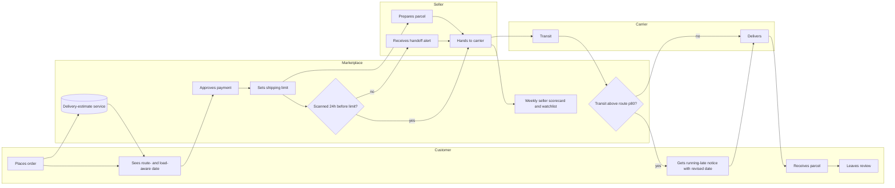

# To-be process: order to delivery

Three checkpoints are added: a route- and load-aware promise at checkout (FR-01), a handoff alert before the shipping limit (FR-02), and a running-late notice during transit (FR-03).

**What changes**

| Checkpoint | Owner | Requirement | Target |
| --- | --- | --- | --- |
| Route- and load-aware promise | Logistics product | FR-01 | Late rate 5.0% or lower at no more than 25.0 promised days |
| Handoff alert, scorecard, watchlist | Seller operations | FR-02 | Late handoffs 5.0% or lower |
| Running-late notice | Customer experience | FR-03 | Late-order review score 3.0 or higher |
